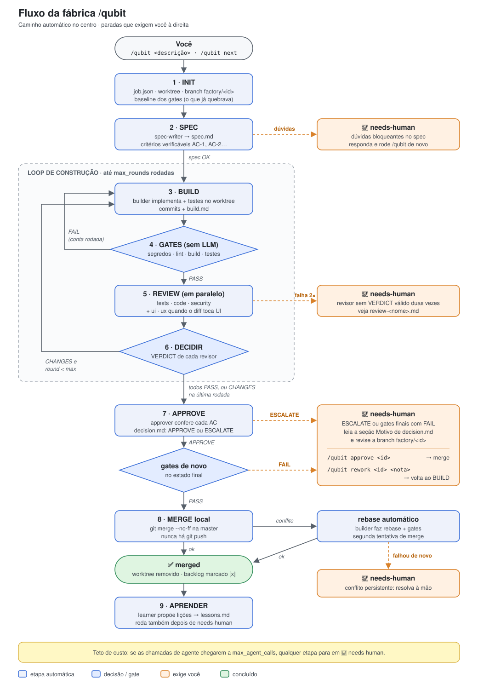

# qubit-factory

Uma **software factory** independente de linguagem (hoje configurada para um app iOS em Swift 6 / SwiftUI): o comando `/qubit` recebe um pedido (feature, bug ou refactor) e um time de agentes escreve o spec, implementa numa branch isolada, passa por gates determinísticos, é revisado por especialistas e, se tudo estiver certo, faz o merge local na `master`. Quando algo foge do previsto, a fábrica para e chama você.

A stack não está fixa no código da fábrica: ela vem de um **perfil** (`ios`, `android`, `web`, `python` ou `generic`), escolhido em `factory/config.sh`. Veja [Perfis de stack](#perfis-de-stack).

> Referência técnica curta: [`factory/README.md`](factory/README.md). Regra completa do orquestrador: [`.claude/skills/qubit/SKILL.md`](.claude/skills/qubit/SKILL.md).

## Sumário

- [Visão geral](#visão-geral)
- [Fluxo completo](#fluxo-completo)
- [Etapas em detalhe](#etapas-em-detalhe)
- [Comandos e exemplos](#comandos-e-exemplos)
- [Quando precisa de intervenção humana](#quando-precisa-de-intervenção-humana)
- [Agentes e modelos](#agentes-e-modelos)
- [Tipos de job](#tipos-de-job)
- [Estado, arquivos e dashboard](#estado-arquivos-e-dashboard)
- [Perfis de stack](#perfis-de-stack)
- [Configuração](#configuração)
- [Garantias e proteções](#garantias-e-proteções)
- [Limites conhecidos](#limites-conhecidos)

---

## Visão geral

| Peça | Onde | O que faz |
|---|---|---|
| Orquestrador | [`.claude/skills/qubit/SKILL.md`](.claude/skills/qubit/SKILL.md) | A sessão que recebe `/qubit`. Dispara agentes, roda gates, é o único que escreve `job.json` e faz o merge. |
| Subagentes (9) | [`.claude/agents/`](.claude/agents/) | Spec, build, 5 revisores, aprovação e aprendizado. Cada um escreve só o próprio arquivo. |
| Gates | [`scripts/factory-gates.sh`](scripts/factory-gates.sh) | Verificação sem LLM: segredos no diff, lint/formato/tipos, build e testes, com os comandos do perfil. |
| Guarda | [`.claude/hooks/guard.sh`](.claude/hooks/guard.sh) | Hook `PreToolUse` que bloqueia `git push`, `rm -rf` amplo e edição de gates/config pelos agentes. |
| Config | [`factory/config.sh`](factory/config.sh) | Perfil de stack, comandos dos gates, limites de rodadas e de chamadas. |
| Perfis | [`factory/profiles/`](factory/profiles/) | Um par `<perfil>.sh` (comandos e detecção) + `<perfil>.md` (convenções e checklists dos agentes) por stack. |
| Fila | [`factory/backlog.md`](factory/backlog.md) | Itens consumidos por `/qubit next`. |
| Memória | [`factory/lessons.md`](factory/lessons.md) | Lições aprendidas entre jobs, lidas pelo builder e pelo spec-writer. |
| Estado | `factory/jobs/<job-id>/` | Arquivos de cada job (local, fora do git). |
| Dashboard | [`factory/dashboard.html`](factory/dashboard.html) | Linha do tempo, rodadas e decisões de cada job. |

**Princípios:**

1. **Estado em arquivos, não na conversa.** Os agentes recebem caminhos, nunca resumos.
2. **Isolamento.** Cada job roda num `git worktree` próprio (`../qubit-factory-factory/<job-id>`) na branch `factory/<job-id>`.
3. **Verificação barata primeiro.** Gates determinísticos rodam antes de qualquer revisor; falha de gate não gasta LLM.
4. **Revisão independente.** Revisores não leem o relato do builder: conferem o diff e rodam o código.
5. **Nada sai da máquina.** Nunca há `git push`; o merge é local e só acontece com `APPROVE`.

---

## Fluxo completo



> A imagem é um SVG versionado em [`docs/images/factory-flow.svg`](docs/images/factory-flow.svg). Ao mudar o fluxo em `.claude/skills/qubit/SKILL.md`, atualize a imagem junto.

Status possíveis de um job (`job.json.status`): `spec` → `building` → `gates` → `reviewing` → `approving` → `merged`, ou `needs-human` / `failed`.

---

## Etapas em detalhe

| # | Etapa | Quem | Entrada | Saída | Para onde vai |
|---|---|---|---|---|---|
| 1 | **INIT** | orquestrador | descrição, tipo | `job.json`, worktree, `baseline.md` | SPEC |
| 2 | **SPEC** | `spec-writer` | descrição, tipo, `lessons.md` | `spec.md` com ACs numerados | BUILD, ou `needs-human` se houver dúvidas bloqueantes |
| 3 | **BUILD** | `builder` | `spec.md`, `lessons.md`, `baseline.md` (+ achados da rodada anterior) | commits na branch, `build.md` | GATES |
| 4 | **GATES** | `factory-gates.sh` | worktree | `round-<n>/gates.md` (`GATES: PASS/FAIL`) | `FAIL` → BUILD (conta rodada) · `PASS` → REVIEW |
| 5 | **REVIEW** | revisores em paralelo | diff + código (sem `build.md`) | `round-<n>/review-<nome>.md` (`VERDICT: PASS/CHANGES`) | DECIDIR |
| 6 | **DECIDIR** | orquestrador | primeira linha de cada review | — | todos `PASS` → APPROVE · `CHANGES` → BUILD (ou APPROVE na última rodada) |
| 7 | **APPROVE** | `approver` + gates finais | spec, todas as rodadas, baseline | `decision.md` (`APPROVE`/`ESCALATE`), `final-gates.md` | MERGE ou `needs-human` |
| 8 | **MERGE** | orquestrador | branch `factory/<id>` | merge `--no-ff` na `master` | `merged`, ou `needs-human` em conflito persistente |
| 9 | **APRENDER** | `learner` (só leitura) | job atual + jobs anteriores | linhas novas em `lessons.md` | fim |

**Quais revisores rodam:**

| Revisor | Quando |
|---|---|
| `reviewer-tests` | sempre |
| `reviewer-code` | sempre |
| `reviewer-security` | sempre |
| `reviewer-ui` | `bash scripts/factory-gates.sh ui <wt>` responde `UI: yes` (o perfil define quais arquivos são interface; no `ios`: `.swift` com `import SwiftUI`/`UIKit`, `*.xcassets`, `*.storyboard`, `*.xib`, `*.strings`, `*.xcstrings`) |
| `reviewer-ux` | mesma condição do `reviewer-ui` **e** o job não é refactor |

**Commit de merge:** `type(<job-id>): <title>` em inglês, no imperativo, com `type` = `feat`, `fix` ou `refactor` conforme o tipo do job.

---

## Comandos e exemplos

> **Antes de qualquer comando:** troque o modelo da sessão para **Sonnet 5.5** ou **Haiku 5.5**. O orquestrador roda no modelo da sessão; os subagentes têm modelo fixo. Num fluxo equivalente (geração anterior), o custo foi de US$ 2,65 com Haiku contra US$ 43,68 com Opus. Se a sessão estiver em Opus, a fábrica avisa antes de começar.

| Comando | O que faz |
|---|---|
| `/qubit <descrição>` | Novo job; o tipo (feature, bug, refactor) é inferido da descrição. |
| `/qubit --feature <descrição>` | Força o tipo feature. |
| `/qubit --bug <descrição>` | Força bug: exige teste de regressão que falha antes e passa depois. |
| `/qubit --refactor <descrição>` | Força refactor: sem mudar comportamento nem alterar testes existentes. |
| `/qubit next` | Pega o primeiro `- [ ]` de `factory/backlog.md`, marca como `- [~] <job-id>` e roda. |
| `/qubit status` | Lista os jobs: id, tipo, status, rodada e chamadas de agente. |
| `/qubit approve <job-id>` | Para um job em `needs-human`: faz o merge depois que você revisou. |
| `/qubit rework <job-id> <nota>` | Grava sua nota em `human-note.md`, zera a rodada e devolve ao builder. |

### Exemplos

**Feature nova**

```text
/qubit Tela de configurações com seletor de tema (claro, escuro, sistema) persistido em UserDefaults
```

**Bug**

```text
/qubit --bug O contador da tela inicial não zera ao reabrir o app depois de encerrado pelo sistema
```

**Refactor**

```text
/qubit --refactor Extrair a camada de rede para um protocolo injetável, sem mudar o comportamento
```

**Trabalhar pela fila**

```markdown
<!-- factory/backlog.md -->
- [ ] [feature] Tela de onboarding com 3 páginas e botão "Pular"
- [ ] [bug] Lista de favoritos duplica itens ao puxar para atualizar
- [ ] [refactor] Trocar callbacks do AuthService por async/await
```

```text
/qubit next
```

**Acompanhar e decidir**

```text
/qubit status
/qubit approve 004-onboarding
/qubit rework 004-onboarding O botão "Pular" precisa ficar visível também na última página e ter label de VoiceOver
```

### Comandos de apoio (terminal)

Dashboard dos jobs:

```bash
python3 -m http.server -d factory 8000
```

Depois abra http://localhost:8000/dashboard.html.

Rodar os gates manualmente:

```bash
bash scripts/factory-gates.sh run .
```

Autoteste da fábrica (sem LLM; rode depois de mexer em agentes, hook, gates ou skill):

```bash
bash scripts/factory-selftest.sh
```

Inspecionar um job:

```bash
head -1 factory/jobs/<job-id>/decision.md
```

---

## Quando precisa de intervenção humana

A fábrica é autônoma no caminho feliz. Ela **para com status `needs-human`** e mostra o `job-id`, o motivo e o caminho do arquivo relevante nas situações abaixo.

### Paradas automáticas

| Situação | Onde aparece | O que fazer |
|---|---|---|
| **Dúvidas bloqueantes no spec** — o pedido é ambíguo ou falta decisão de produto | seção `## Dúvidas bloqueantes` de `spec.md` | Responda as dúvidas e rode `/qubit` de novo com a descrição mais completa. |
| **`ESCALATE` do approver** — algum AC não foi comprovado, ou revisores ainda pedem mudanças na última rodada | seção `## Motivo` de `decision.md` | Revise o diff na branch `factory/<id>`. Se estiver bom: `/qubit approve <id>`. Se não: `/qubit rework <id> <nota>`. |
| **Gates finais falharam** depois de um `APPROVE` | `final-gates.md` | Trate como `ESCALATE`: `rework` com a correção esperada. |
| **Revisor falhou duas vezes** (arquivo ausente ou sem `VERDICT:` válido) | `round-<n>/review-<nome>.md` | Veja o que travou o revisor; normalmente `rework` ou rodar de novo resolve. |
| **Teto de custo atingido** (`len(events) >= max_agent_calls`) | `decision.md` escrito pelo orquestrador | Avalie se vale continuar (`rework`) ou abandonar; ajuste o limite em `factory/config.sh` se for o caso. |
| **Conflito de merge persistente** (falhou mesmo após rebase automático) | saída do merge | Resolva o conflito à mão na `master` ou peça `rework` depois de atualizar a base. |

### Decisões que são sempre suas

- **Configurar o projeto** antes do primeiro uso: escolher o perfil e preencher `factory/config.sh` (comandos que o perfil não detectar; no `ios`, o scheme) e as seções `_preencher_` do [`CLAUDE.md`](CLAUDE.md). Sem isso os gates falham de propósito.
- **Escolher o modelo da sessão** (Sonnet 5.5 ou Haiku 5.5) antes de `/qubit`.
- **Aprovar dependências de terceiros:** só entram se o spec disser explicitamente.
- **Alterar as regras da fábrica:** `.claude/`, `scripts/factory-*`, `factory/config.sh`, `factory/profiles/`, `factory/lessons.md` e `CLAUDE.md`. O hook impede os agentes de mexer nesses arquivos dentro dos worktrees.
- **Publicar:** a fábrica nunca faz `git push`. Subir a `master` para o remoto é com você.
- **Curar as lições:** o `learner` acrescenta linhas a `lessons.md`; revise de vez em quando e remova o que não fizer mais sentido.
- **Abandonar um job:** não há comando; remova o worktree e a branch:

```bash
git worktree remove ../qubit-factory-factory/<job-id>
```

```bash
git branch -D factory/<job-id>
```

---

## Agentes e modelos

| Agente | Modelo / effort | Papel | Escreve |
|---|---|---|---|
| orquestrador (`/qubit`) | **o da sessão** (Sonnet 5.5 ou Haiku 5.5) | dispara agentes, lê primeiras linhas, atualiza estado | `job.json` |
| `spec-writer` | Opus 5.5 / high | spec com ACs verificáveis | `spec.md` |
| `builder` | Opus 5.5 / high | implementa com testes, no worktree | commits + `build.md` |
| `reviewer-tests` | Opus 5.5 / high | confere ACs e testes sem ler `build.md` | `review-tests.md` |
| `reviewer-code` | Sonnet 5.5 / medium | correção, arquitetura, concorrência, performance | `review-code.md` |
| `reviewer-security` | Opus 5.5 / high | segredos, armazenamento, rede, entrada não confiável, privacidade (checklist do perfil) | `review-security.md` |
| `reviewer-ui` | Sonnet 5.5 / medium | fonte escalável, tema, layout, acessibilidade técnica (checklist do perfil) | `review-ui.md` |
| `reviewer-ux` | Sonnet 5.5 / medium | fluxo, estados, feedback, guias da plataforma, leitor de tela (checklist do perfil) | `review-ux.md` |
| `approver` | Opus 5.5 / high | confere cada AC contra as evidências | `decision.md` |
| `learner` | Sonnet 5.5 / low | propõe lições comparando com jobs anteriores | nada (o orquestrador grava) |

Os IDs exatos (`claude-opus-5-5`, `claude-sonnet-5-5`) e o `effort` estão fixos no frontmatter de cada agente. Todo agente termina com um bloco `RELATÓRIO <agente>` de até 15 linhas, que é tudo o que o orquestrador lê.

---

## Tipos de job

| Tipo | Regra extra | Revisores |
|---|---|---|
| **feature** | Spec com ACs; testes novos cobrem cada AC. | todos os aplicáveis |
| **bug** | O builder escreve **primeiro** um teste que reproduz o bug e falha, registra a falha em `build.md`, e só então corrige. Sem teste de regressão, não há aprovação. | todos os aplicáveis |
| **refactor** | Testes de caracterização **antes** de mexer; o diff não pode alterar testes existentes, só acrescentar. Comportamento externo não muda. | sem `reviewer-ux` |

---

## Estado, arquivos e dashboard

Cada job vive em `factory/jobs/<NNN-slug>/` (ignorado pelo git):

```text
factory/jobs/004-onboarding/
├── job.json            # estado: status, rodada, revisores, eventos (cada chamada de agente)
├── baseline.md         # gates antes do job
├── spec.md             # critérios de aceitação
├── build.md            # relato do builder
├── human-note.md       # sua nota, se houve /qubit rework
├── round-1/
│   ├── gates.md
│   └── review-*.md
├── round-2/ …
├── decision.md         # APPROVE ou ESCALATE + motivo
├── final-gates.md      # gates no estado final
└── logs/               # saída completa de build e testes
```

O worktree do job fica fora do repo, em `../qubit-factory-factory/<job-id>`, e é removido depois do merge.

O **dashboard** (`factory/dashboard.html`) lê esses arquivos e mostra etapas, linha do tempo e abas por rodada. Sirva a pasta `factory` com `python3 -m http.server -d factory 8000`.

---

## Perfis de stack

Tudo o que depende de linguagem fica em [`factory/profiles/`](factory/profiles/). Cada perfil tem dois arquivos:

- **`<perfil>.sh`**: lido pelos gates. Detecta o projeto e preenche os comandos que a config deixou vazios; declara quais arquivos contam como interface.
- **`<perfil>.md`**: lido pelos agentes. Seções fixas (`Stack`, `Código`, `Testes`, `Segurança`, `UI`, `UX`, `Spec`, `Logs`, `Skills`); cada agente lê só as do seu papel.

| Perfil | Stack | Comandos detectados |
|---|---|---|
| `ios` | Swift / SwiftUI | `xcodebuild` (com `FACTORY_SCHEME`) ou `swift build`/`swift test`; SwiftLint; swift-format se houver `.swift-format` |
| `android` | Kotlin / Java, Gradle | `./gradlew lint`, `assembleDebug`, `testDebugUnitTest`; ktlint/spotless/detekt se configurados |
| `web` | JS / TS (frontend ou Node) | scripts do `package.json` (`lint`, `format:check`, `typecheck`, `build`, `test`) com npm/pnpm/yarn/bun; instala dependências se faltar `node_modules` |
| `python` | Python | `uv sync`/`poetry install`; `ruff check`, `ruff format --check`, `mypy` se configurado, `pytest` |
| `generic` | qualquer | nenhum: tudo vem da config |

Para outra stack (Go, Rust, Flutter...), copie `generic.sh`/`generic.md`, preencha e rode o autoteste. O contrato completo está em [`factory/profiles/README.md`](factory/profiles/README.md). As convenções específicas do projeto continuam no [`CLAUDE.md`](CLAUDE.md) e vencem o perfil.

---

## Configuração

[`factory/config.sh`](factory/config.sh):

| Variável | Padrão | Para quê |
|---|---|---|
| `FACTORY_PROFILE` | `ios` | perfil de stack (`factory/profiles/<perfil>.sh` + `.md`) |
| `FACTORY_SETUP_CMD` | vazio (perfil) | instala dependências antes dos gates |
| `FACTORY_LINT_CMD` / `FACTORY_FORMAT_CMD` / `FACTORY_TYPECHECK_CMD` | vazio (perfil) | opcionais; binário ausente = pulado |
| `FACTORY_BUILD_CMD` | vazio (perfil) | opcional em linguagens interpretadas |
| `FACTORY_TEST_CMD` | vazio (perfil) | **obrigatório**, aqui ou detectado pelo perfil |
| `FACTORY_REQUIRE_TOOLS` | `0` | `1` falha se o binário de lint/formato/tipos não estiver instalado |
| `FACTORY_WORKSPACE` / `FACTORY_PROJECT` / `FACTORY_SCHEME` / `FACTORY_DESTINATION` | — | só no perfil `ios` |
| `FACTORY_MAX_ROUNDS` | `2` | rodadas de retrabalho do builder |
| `FACTORY_MAX_AGENT_CALLS` | `20` | teto de chamadas de subagente por job |
| `GATE_TIMEOUT_SECONDS` | `1800` | teto por comando de build/teste |
| `FACTORY_ALLOW_NO_PROJECT` | `0` | permite gates `PASS` sem comando de teste; mantenha `0` |

Valor preenchido na config sempre vence o padrão do perfil. Mantenha os comandos do [`CLAUDE.md`](CLAUDE.md) em sincronia com esse arquivo.

---

## Garantias e proteções

- **Gates sem LLM:** segredos no diff, preparação, lint/formato/tipos, build e testes, com os comandos do perfil. Sem comando de teste, falham de propósito: um gate que passa sem rodar nada é pior que nenhum.
- **Baseline:** o builder só responde pelo que piorou em relação ao estado antes do job.
- **Revisores independentes:** não leem `build.md`; verificam o diff e rodam o código.
- **Gates finais:** mesmo com `APPROVE`, os gates rodam de novo antes do merge.
- **Teto de custo:** `max_rounds` e `max_agent_calls` por job; cada chamada fica registrada em `job.json`.
- **Hook de guarda:** bloqueia `git push`, apagar `master`/`main`, `reset --hard origin`, `rm -rf` amplo, `curl | sh`, e edição de `.claude/`, `scripts/factory-*`, `factory/config.sh`, `factory/profiles/`, `factory/lessons.md` e `CLAUDE.md` dentro dos worktrees.
- **Resiliência:** revisor com saída inválida roda de novo uma vez; conflito de merge tem uma tentativa de rebase. Depois disso, escala.
- **Contexto enxuto:** o orquestrador decide pela primeira linha dos arquivos e pelo `RELATÓRIO` dos agentes; saída de build vai para `logs/`.
- **Memória:** achados repetidos em 2+ jobs viram linha em `lessons.md`.
- **Autoteste:** `scripts/factory-selftest.sh` valida estrutura dos agentes, formatos de veredito, hook e gates sem gastar LLM.

---

## Limites conhecidos

- Os revisores têm `Bash` e `Write` (precisam rodar testes e gravar a revisão). "Não editar código" é regra de prompt, não barreira técnica; o hook só protege gates, hooks e config.
- Não há CI remoto: o gate local faz esse papel. Se adicionar CI, exija-o no passo MERGE.
- `/qubit rework` zera a rodada, então cada rework pode consumir de novo até `max_rounds` rodadas (ainda limitado por `max_agent_calls`).

---

## Convenções do projeto

Resumo; a fonte é o [`CLAUDE.md`](CLAUDE.md).

- Perfil atual: `ios` (Swift 6, SwiftUI); as regras da stack estão em [`factory/profiles/ios.md`](factory/profiles/ios.md).
- Texto localizável e acessível.
- Segredos fora do repo; dados sensíveis no armazenamento seguro da plataforma.
- Dependência de terceiros só com aprovação no spec.
- Commits em inglês, no imperativo: `type(scope): summary`.
